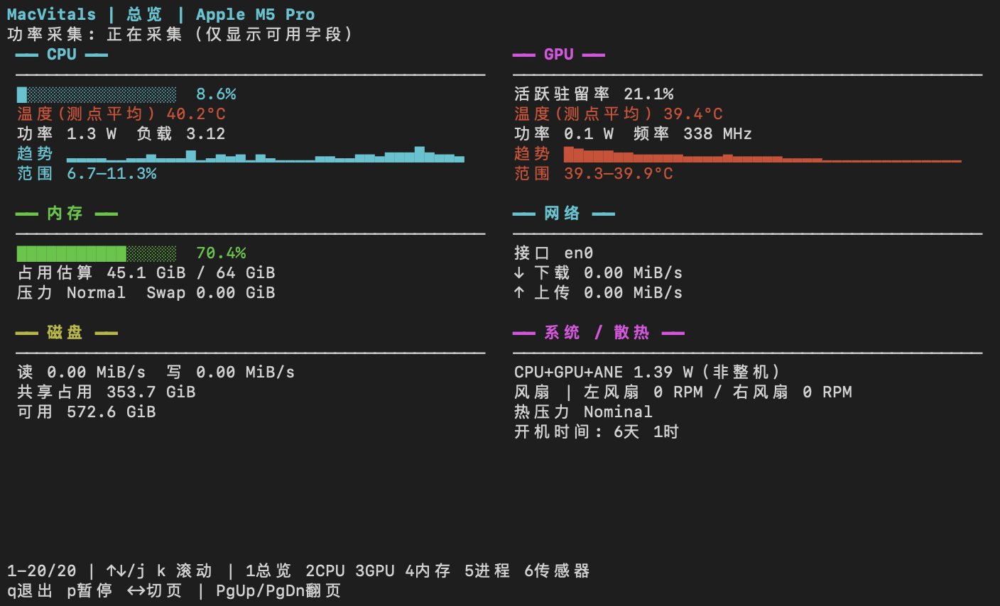
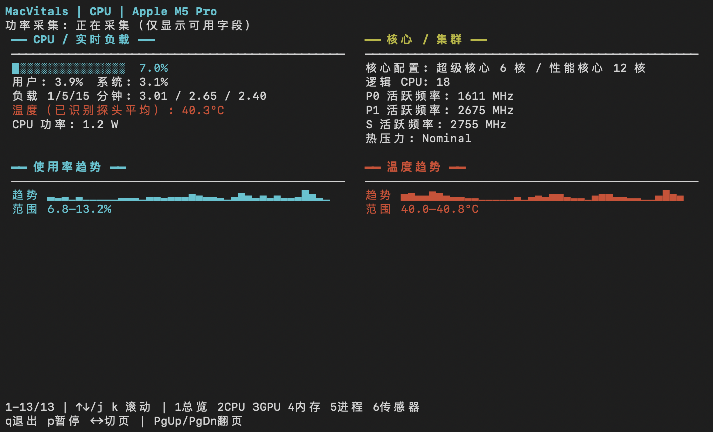
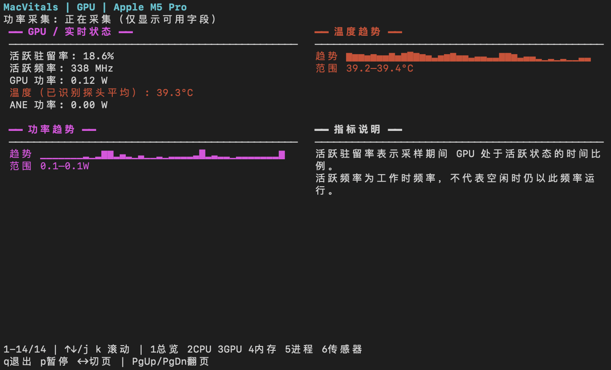
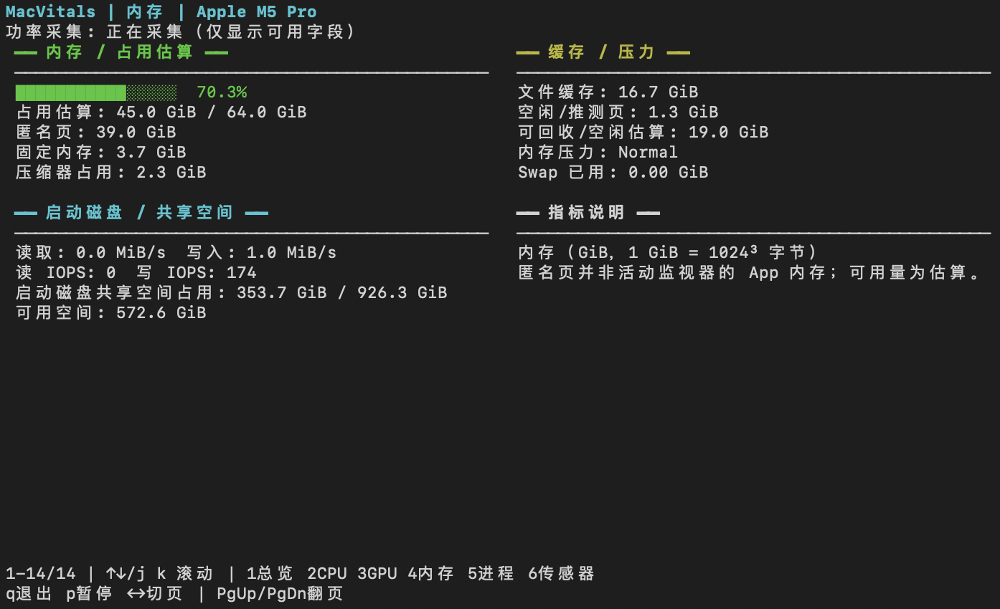
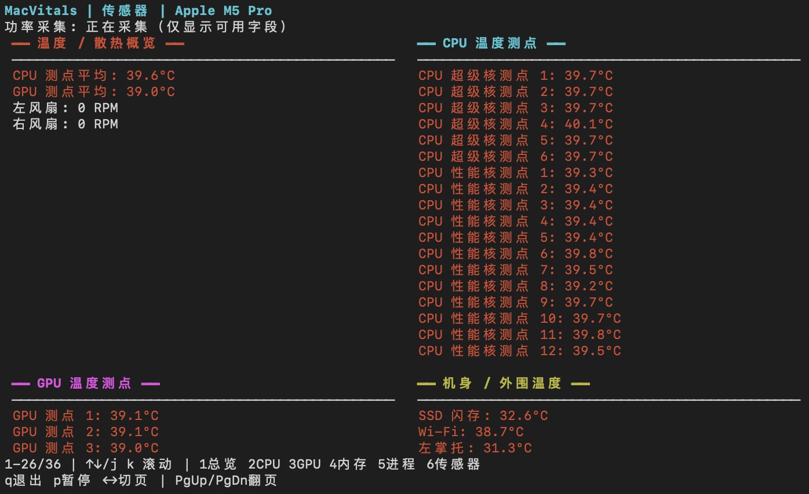

# MacVitals

[简体中文](README.md) | [English](README_EN.md)

> SSH-first live system monitor for Apple Silicon Macs.

面向 Apple Silicon Mac 的轻量终端监视器。在本机或 SSH 会话中，一起查看硬件状态、应用资源占用和 Docker 容器。

**当前版本：1.5.0 · Python 3.9+ · 无第三方 Python 运行依赖**

## 为 SSH 远程观察而做

MacVitals 与 Stats、Activity Monitor 等 GUI 工具服务于不同场景。Stats 适合本机菜单栏观察；MacVitals 适合人在外面，通过 SSH 连接家里的 Mac，随手打开就能看清机器和服务现在的状态。

- 无需桌面环境，不经过第三方服务器。
- 随用随开；不保存监控历史、运行日志或云端数据，退出即结束。
- 彩色分块仪表盘，宽屏双栏、窄屏单栏，支持滚动。
- CPU、GPU、内存、应用/进程、传感器和 Docker 分页展示，操作提示集中在底栏。

## 1.5.0 新功能

- **按 App 看资源占用：** 合并主进程、包内 Helper 和可识别的系统辅助进程，显示应用 CPU、内存与进程数；也可切回独立进程并展开应用成员。
- **Docker 监控：** 在硬件指标旁查看容器状态、CPU、内存和 I/O，按 Compose 项目分组，或进入项目/服务只读视图。
- **常用容器操作：** 启动、停止、重启、暂停、恢复；查看临时日志和精简 inspect，减少反复输入命令。

## 界面预览

以下截图来自 1.4.0，展示硬件页面的配色与布局。



<details>
<summary>查看更多页面 / More views</summary>

### CPU



### GPU



### 内存



### 传感器



</details>

## 安装与运行

在要监测的 Mac 上克隆仓库：

```bash
git clone https://github.com/Macchen666816/macvitals.git
cd macvitals
python3 -m macvitals
```

使用 [uv](https://docs.astral.sh/uv/) 安装命令入口：

```bash
uv tool install --force --reinstall --from . macvitals
macvitals
```

更新时先退出旧程序，在仓库目录执行：

```bash
git pull --ff-only
uv tool install --force --reinstall --from . macvitals
```

如果 shell 找不到命令，可运行 `uv tool update-shell` 后重新打开终端。也可以在虚拟环境中使用 `python3 -m pip install .` 安装。

CPU、内存、应用/进程等基础指标无需管理员权限。使用以下命令启用功率、频率等特权采样，并提高进程读取覆盖：

```bash
sudo "$(command -v macvitals)"
```

源码运行也支持 `sudo python3 -m macvitals`。通过 SSH 使用时，在被监测的 Mac 上运行。复制源码时请携带整个 `macvitals/` 目录。

常用参数：

```bash
macvitals --interval 1          # 刷新间隔 0.5–10 秒
macvitals --no-docker           # 关闭 Docker 采集
macvitals --docker-context NAME # 选择本地 Docker context
macvitals --dev                 # 显示当前来源、采样状态与数据年龄
```

## 页面与操作

| 按键 | 功能 |
|---|---|
| `1–7` | 总览、CPU、GPU、内存、应用/进程、传感器、Docker |
| `← / →` | 切换页面 |
| `↑ / ↓` 或 `k / j` | 滚动；`PgUp/PgDn` 翻页，`Home/End` 跳至开头/末尾 |
| `p` / `q` | 暂停监测 / 退出 |
| `c / m` | 应用、进程或容器按 CPU / 内存排序 |
| 应用页 `v` | 切换应用 / 独立进程，排行各显示前 15 名 |
| 应用页 `n / b`、`Enter`、`Esc` | 选择应用、展开前 15 个成员、收起 |
| Docker 页 `v` / `g` | 切换容器/项目视图；切换容器分组 |
| Docker 页 `n / b`、`d` | 选择容器/项目；展开容器详情 |
| Docker 项目视图 `Enter` / `Esc` | 展开 / 收起服务和已有容器 |
| Docker 页 `o` | 打开所选容器操作面板 |
| Docker 页 `l / i / x` | 临时日志 / 精简 inspect / 清除结果 |
| Docker 页 `h` | 展开常用命令参考 |

## Docker

Docker 是可选功能，需要本机 Docker CLI 和可访问的引擎；当前已在 Mac mini / OrbStack 上实测，Docker Desktop 与 Colima 尚未实测。支持本地 Unix endpoint 的 context。

容器列表显示状态、CPU 和内存；详情包含镜像、端口、启动时间、重启次数及累计网络/块设备 I/O。后台采集至少间隔 3 秒，与主机刷新间隔独立。

按 `o` 打开操作面板，用 `s/t/r/p/u` 选择启动、停止、重启、暂停或恢复。确认页默认取消，`Tab` 或左右键切换，`Enter` 确认，`Esc` 退出。停止或重启会中断服务；启动单个容器不会自动启动依赖服务。执行后会重新读取容器状态。

`l` 读取最近最多 80 行日志，`i` 查看精简 inspect。结果只保存在当前会话内存；inspect 不包含环境变量、挂载和命令参数。容器日志可能包含业务信息，分享前请自行检查。

Compose 项目/服务视图用于观察现有容器，不执行整组操作。更多设计见 [Docker Compose 设计](docs/DOCKER_COMPOSE_DESIGN.md)，单容器操作实现见 [docker_actions.py](macvitals/docker_actions.py)。sudo 启动时，Docker CLI 仍以原用户身份连接原来的引擎。

## 指标怎么读

- **主机与 App CPU：** 全部逻辑核心合计为 100%；18 核机器上一个核心满载约占 5.6%。CPU 使用相邻采样的累计时间差，首帧建立基线。
- **App 内存：** 使用 macOS footprint 汇总成员，包含压缩内存等系统记账项目。应用按完整包路径区分，系统责任进程接口补充 XPC 归属；未归属任务可在进程视图查看。`≥` 为部分成员合计，`--` 为等待或未读值。
- **RSS 降级：** 原生进程采集不可用时，进程视图回退 `ps` CPU/RSS，暂不提供应用聚合。
- **Docker CPU/内存：** CPU 100% 约为一个虚拟核，可超过 100%；内存采用 Docker CLI 的缓存扣减口径，上限来自容器或引擎。它们与主机指标使用不同分母。
- **温度与风扇：** CPU/GPU 温度为已识别探头平均值，风扇以 RPM 显示；探头随机型而异。
- **功率：** CPU + GPU + ANE 为计算单元功率合计；整机功耗还包含其他部件。
- **系统内存：** 结合内存压力与交换空间判断紧张程度；分类数值包含估算。

## 验证与诊断

1.5.0 在本机与 Mac mini 均通过 135 项自动测试，包括 App 聚合、时间基准换算、PID 重用、Docker 解析与操作确认，以及三种 TERM 的真实终端缩放。18 核 Mac 的单核测试测得 5.53%，理论值为 5.56%；Mac mini / OrbStack 的隔离测试容器通过启动、重启、停止并完成清理。

```bash
python3 -m unittest discover -s tests -v
macvitals --diagnose
```

诊断 JSON 包含硬件、来源与采集覆盖计数，省略应用/进程名称、命令行和容器身份。开发对照探针使用 `--ioreport-probe`、`--compare-probes`；历史硬件验证见 [validation](validation/) 和 [更新记录](CHANGELOG.md)。

## 兼容与贡献

MacVitals 主要面向 Apple Silicon。不同芯片和 macOS 版本提供的传感器、核心拓扑与 powermetrics 字段有所不同；Ultra 系列仍欢迎社区补充实机反馈。

发现问题欢迎提交 Issue 或 Pull Request，附上芯片型号、macOS 版本、脱敏后的 `--diagnose` 和复现步骤。贡献方式见 [CONTRIBUTING.md](CONTRIBUTING.md)，安全问题见 [SECURITY.md](SECURITY.md)。

## 许可证

当前提供 Python 源码版，使用系统接口采集，不控制风扇或修改散热策略。

[MacVitals Non-Commercial Share-Alike License](LICENSE) 允许免费非商业使用；对外发布修改版须公开完整源码并延续相同许可，禁止商业收费。它是项目专用的源码公开许可证，不是 OSI 认证的开源许可证。
