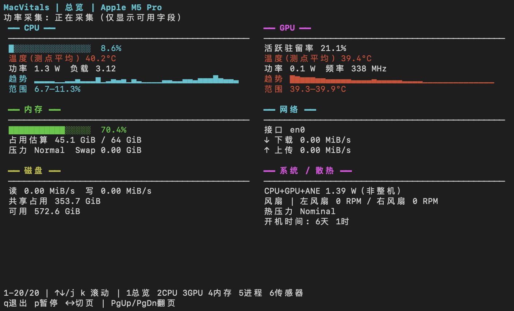
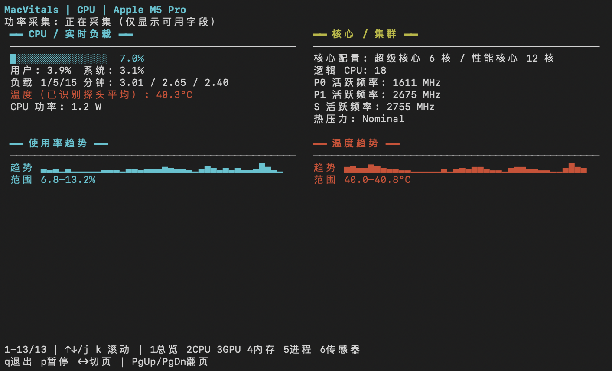
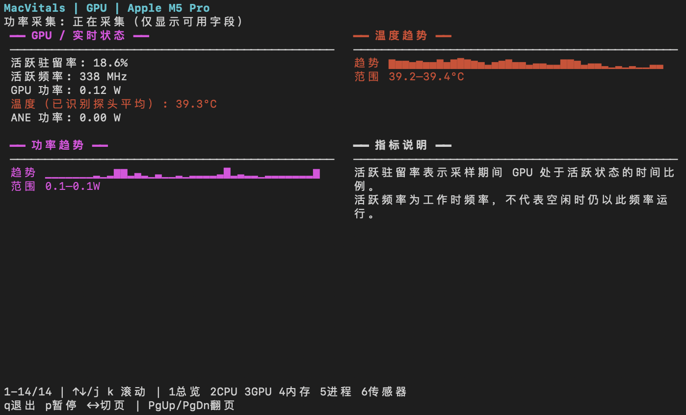
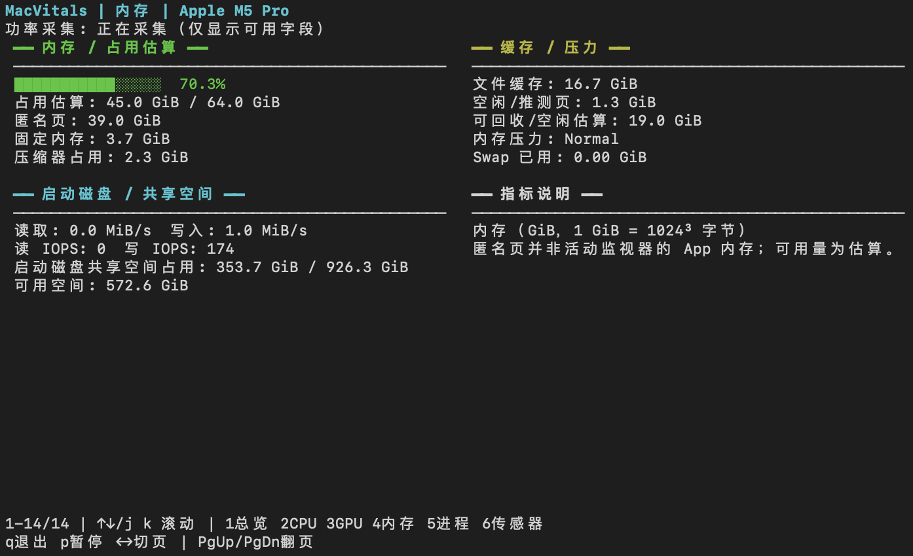
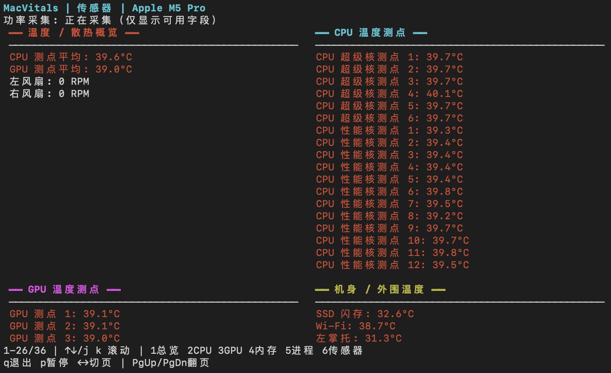

# MacVitals

[简体中文](README.md) | [English](README_EN.md)

> SSH-first live system monitor for Apple Silicon Macs.

A lightweight terminal monitor for Apple Silicon Macs. View hardware, application resource usage, and Docker containers together, locally or over SSH.

**Version 1.5.0 · Python 3.9+ · No third-party Python runtime dependencies**

## Built for SSH

MacVitals serves a different setting from GUI tools such as Stats and Activity Monitor. Stats fits local menu bar monitoring; MacVitals fits opening an SSH session to your Mac at home and quickly checking the machine and its services.

- No desktop environment or third-party server required.
- Open when needed and close when finished. No monitoring history, runtime logs, or cloud data are stored.
- Colored dashboard panels, two columns on wide terminals, one column on narrow terminals, and scrolling throughout.
- Dedicated pages for CPU, GPU, memory, apps/processes, sensors, and Docker, with controls in the bottom bar.

## New in 1.5.0

- **Resource usage by app:** Aggregate main processes, bundled helpers, and identified system helpers into app CPU, memory, and process counts. Switch to individual processes or expand an app's members.
- **Docker monitoring:** Check container state, CPU, memory, and I/O beside hardware metrics. Group containers by Compose project or browse read-only projects and services.
- **Common container actions:** Start, stop, restart, pause, and resume containers; inspect temporary logs and a compact inspect summary.

## Preview

These screenshots are from 1.4.0 and show the hardware pages' colors and layout.



<details>
<summary>More views</summary>

### CPU



### GPU



### Memory



### Sensors



</details>

## Install and Run

Clone the repository on the Mac you want to monitor:

```bash
git clone https://github.com/Macchen666816/macvitals.git
cd macvitals
python3 -m macvitals
```

Install the command with [uv](https://docs.astral.sh/uv/):

```bash
uv tool install --force --reinstall --from . macvitals
macvitals
```

To update, exit the running monitor and run these commands from the repository:

```bash
git pull --ff-only
uv tool install --force --reinstall --from . macvitals
```

If your shell cannot find the command, run `uv tool update-shell` and reopen the terminal. Alternatively, install with `python3 -m pip install .` inside a virtual environment.

CPU, memory, and app/process metrics work without administrator privileges. Enable power and frequency sampling, and improve process-reading coverage, with:

```bash
sudo "$(command -v macvitals)"
```

For source execution, use `sudo python3 -m macvitals`. Over SSH, run it on the Mac being monitored. When copying source, include the entire `macvitals/` directory.

Useful options:

```bash
macvitals --interval 1          # Refresh every 0.5–10 seconds
macvitals --no-docker           # Disable Docker collection
macvitals --docker-context NAME # Select a local Docker context
macvitals --dev                 # Show live sources, sampling state, and data age
```

## Pages and Controls

| Key | Action |
|---|---|
| `1–7` | Overview, CPU, GPU, Memory, Apps/Processes, Sensors, Docker |
| `Left / Right` | Switch pages |
| `Up / Down` or `k / j` | Scroll; `PgUp/PgDn` page, `Home/End` jump to the beginning/end |
| `p` / `q` | Pause monitoring / quit |
| `c / m` | Sort apps, processes, or containers by CPU / memory |
| Apps page `v` | Switch apps / individual processes; each ranking shows the top 15 |
| Apps page `n / b`, `Enter`, `Esc` | Select an app, expand its top 15 members, collapse |
| Docker page `v` / `g` | Switch containers/projects; toggle container grouping |
| Docker page `n / b`, `d` | Select a container/project; expand container details |
| Docker project view `Enter` / `Esc` | Expand / collapse services and existing containers |
| Docker page `o` | Open actions for the selected container |
| Docker page `l / i / x` | Temporary logs / compact inspect / clear results |
| Docker page `h` | Expand the command reference |

## Docker

Docker is optional and requires a local Docker CLI and an accessible engine. Mac mini / OrbStack has been live-tested; Docker Desktop and Colima have not yet been live-tested. Contexts must use a local Unix endpoint.

The container list shows state, CPU, and memory. Details include image, ports, start time, restart count, and cumulative network/block I/O. Background polling runs at least 3 seconds apart, independently of host refresh timing.

Press `o`, then `s/t/r/p/u` to select start, stop, restart, pause, or resume. Confirmation defaults to Cancel; use `Tab` or arrow keys to change it, `Enter` to confirm, and `Esc` to close. Stop and restart interrupt the service; starting one container does not start its dependencies. Container state is queried again after execution.

`l` reads up to 80 recent log lines; `i` shows a compact inspect summary. Results stay in current-session memory. Inspect omits environment variables, mounts, and command arguments. Container logs may contain business information, so check before sharing them.

The Compose project/service view observes existing containers and does not execute group actions. See the [Compose design](docs/DOCKER_COMPOSE_DESIGN.md) and [single-container action implementation](macvitals/docker_actions.py) for details. When launched with sudo, Docker CLI still connects to the engine as the original user.

## Reading the Metrics

- **Host and app CPU:** All logical cores together equal 100%. One fully occupied core on an 18-core Mac is about 5.6%. CPU uses cumulative-time deltas; the first frame establishes a baseline.
- **App memory:** Member processes are summed using macOS footprint, including system accounting for compressed memory. Full bundle paths identify apps, with an optional system responsibility interface supplementing XPC attribution. Unattributed tasks remain in the process view. `≥` marks a partial member sum; `--` marks a pending or unread value.
- **RSS fallback:** If native process collection is unavailable, the process view falls back to `ps` CPU/RSS without app aggregation.
- **Docker CPU/memory:** CPU 100% is approximately one virtual core and can exceed 100%. Memory follows Docker CLI cache subtraction, with container or engine limits. These use different denominators from host metrics.
- **Temperatures and fans:** CPU/GPU temperatures average recognized probes; fan speed uses RPM. Available probes vary by model.
- **Power:** CPU + GPU + ANE is the combined power of those compute units; whole-system consumption also includes other components.
- **System memory:** Use memory pressure and swap to judge contention; category totals include estimates.

## Validation and Diagnostics

Version 1.5.0 passed 135 automated tests on the local Mac and Mac mini, covering app aggregation, timebase conversion, PID reuse, Docker parsing and action confirmation, and real terminal resizing with three TERM values. A single-core load measured 5.53% on an 18-core Mac, compared with the expected 5.56%. A disposable container on Mac mini / OrbStack passed start, restart, and stop, then was removed.

```bash
python3 -m unittest discover -s tests -v
macvitals --diagnose
```

Diagnostic JSON includes hardware, sources, and collection coverage counts, omitting app/process names, command lines, and container identities. Developer comparison probes use `--ioreport-probe` and `--compare-probes`. Historical hardware checks are in [validation](validation/); release changes are in the [changelog](CHANGELOG.md).

## Compatibility and Contributions

MacVitals primarily targets Apple Silicon. Sensor availability, core topology, and powermetrics fields vary across chips and macOS versions. Community testing on Ultra-series Macs is welcome.

For an Issue or Pull Request, include your chip, macOS version, sanitized `--diagnose` output, and reproduction steps. See [CONTRIBUTING.md](CONTRIBUTING.md) and [SECURITY.md](SECURITY.md).

## License

MacVitals is distributed as Python source. It reads system metrics without controlling fans or changing thermal policies.

The [MacVitals Non-Commercial Share-Alike License](LICENSE) permits free non-commercial use. Distributed modifications must include complete source code under the same terms; commercial monetization is prohibited. This is a project-specific source-available license, not an OSI-approved open-source license.
